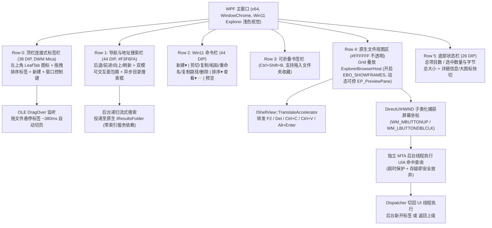

# LeafTab（一叶）架构设计与分阶段实施规范

## 1. 项目定位
**LeafTab（一叶）** 是一款面向 **Windows 10 x64（1903~22H2）与 Windows 11 x64** 的独立轻量级多标签资源管理器。
它通过托管系统公开 COM 接口 `IExplorerBrowser`（`SHELLDLL_DefView`）复用 Windows 原生文件浏览能力，并在外层通过 WPF（`.NET Framework 4.8`）构建与 **Windows 11 文件资源管理器**一致的现代多标签顶栏、面包屑导航栏、命令栏、可折叠书签栏与状态栏——**零 DLL 注入、零 BHO 寄生、零第三方依赖、无商业广告与后台常驻污染**。

---

## 2. 架构定型与六条核心工程边界

| 关键维度 | 实施准则 | 真实能力边界说明 |
| :--- | :--- | :--- |
| **编译位数与环境** | 强制锁定 **`x64`** + `.NET Framework 4.8` + `PerMonitorV2` | 仅编译 `x64` 才能完整加载 64 位系统的第三方 Shell 扩展（夸克网盘、7-Zip、TortoiseGit/SVN、WSL 等）；编译产物为纯净单文件 `LeafTab.exe` |
| **单进程线程边界** | 多标签共享同一 **STA UI 线程**；地址输入对网络路径做异步可达性预检 | 预检仅能改善“手动输入死链”体验，**无法防御**第三方右键扩展卡死或在左侧导航树点击已断开的共享盘——实测中如实记录表现 |
| **视图手势线程模型** | **严禁在 UI 线程同步调用 `IUIAutomation` 查询自身窗口**；统一派发至独立 **MTA 后台线程**（带短超时） | 规避 UIA 同线程自查询跨套间重入/死锁风险；**安全兜底原则：无法 100% 确认命中文件夹（`SFGAO_FOLDER` 且非压缩流 `SFGAO_STREAM`）或纯空白区（`UIItemsView`）时直接放弃手势**，绝不误开目录或误返上级 |
| **跨标签文件拖放** | **“拖文件 → 悬停目标标签 ~380ms → 自动切页（`SW_SHOW`/`SW_HIDE`）→ 放入原生视图”** | 不销毁源视图句柄、不断开系统 OLE `IDataObject` 拖放事务，完整保留复制/移动协商（兼容网盘、手机 MTP、压缩包） |
| **材质分区与浅色完整性** | 聚焦把 **Win11 现代浅色模式**做完整；仅顶栏 38 DIP 标签区启用 DWM Mica 云母，中间文件视图 100% 纯白不透明 | 确保原生 `SHELLDLL_DefView` 的 GDI ClearType 字体锐利不发虚；原生深色模式与后台标签休眠列为阶段三专项验证项 |
| **系统注册表接管** | 阶段三独立可选模块（默认关闭）；遵循 **“备份原值 + 恢复前校验当前值归属”** 双重安全锁 | 关闭开关时先检查当前注册表值是否仍指向 `LeafTab`：若是才恢复旧备份，若期间已被用户安装的其他工具改写则保留现状并提示 |

---

## 3. 界面分区与线程交互架构

---

## 4. 三阶段演进与实施状态

### 阶段一：核心原型与兼容性实测（已完成）
1. **工程与多标签核心骨架**（锁定 `PlatformTarget = x64`）：
   - 托管 `IExplorerBrowser (EBO_SHOWFRAMES)`，保留原生左侧导航树，剔除旧式冗余 `EP_Commands` 与内层状态栏；
   - 实现 `SW_SHOW`/`SW_HIDE` 秒级切页与 `IShellView::TranslateAccelerator` 完整快捷键转发。
2. **两大核心交互落地**：
   - **跨标签拖放文件衔接**：悬停目标标签约 380ms 自动切页，无缝保持系统 OLE 拖放事务；
   - **MTA 后台线程手势识别**：鼠标中键点文件夹后台新开标签、左键双击纯空白处返回上级。
3. **兼容性与资源压测基线**（详见 `COMPATIBILITY_REPORT.md`）：
   - 覆盖此电脑、回收站、WSL、网络死链异步超时预检、1 / 10 / 20 标签负载及 50 次反复开关句柄回落曲线。

### 阶段二：Win11 功能区对齐与日用效率完善（已完成 - v0.3.0）
1. **Win11 资源管理器同款功能区（保留左上角 LeafTab 专属图标）**：
   - **双模可交互面包屑地址栏**：支持点击任意层级跳转、中键点击层级在后台新开标签、点击 `>` 弹出带原生图标的子文件夹菜单、点击空白处或 `Ctrl+L` / `Alt+D` / `F4` 切换完整路径编辑、右侧 `☆/★` 一键收藏；
   - **异步流式目录搜索框（`Ctrl+F` / `F3`）**：支持通配符与子串递归匹配，通过原生 `IResultsFolder` 流式灌入搜索结果，随时 `Esc` 取消并还原原目录视图；
   - **Win11 命令栏**：
     - `⊕ 新建 ▾`：新建文件夹、文本文档（`.txt`）、Markdown（`.md`）、压缩文件夹（`.zip`），创建后自动选中并进入 `SVSI_EDIT` 内联重命名；
     - 常用操作组：`✂ 剪切`、`❐ 复制`、`📋 粘贴`、`[A|] 重命名`、`↪ 复制选中路径`、`🗑 删除`（随选中状态与剪贴板实时启停）；
     - `⇅ 排序 ▾`：按名称、修改日期、类型、大小及递增/递减排序（`IFolderView2::SetSortColumns`）；
     - `☰ 查看 ▾`：超大/大/中/小图标、列表、详细信息、平铺、内容视图切换，以及直接读写系统级**“文件扩展名”**与**“隐藏的项目”**开关（`SHGetSetSettings` + `SHChangeNotify` 实时刷新）；
     - `⋯` 更多菜单与右侧独立 `◫ 预览` 窗格开关（动态控制 `EP_PreviewPane`）。
2. **可折叠书签栏与增强状态栏**：
   - 书签栏（`Ctrl+Shift+B` 显隐，支持左键跳转、中键后台新开标签、直接从文件区拖放文件夹加入书签、右键管理）；
   - 底部状态栏实时统计 `N 个项目 | 选择了 M 个项目  X.XX MB`（基于 `IShellItem2::GetUInt64(PKEY_Size)` 计算选中文件总大小）与右下角 `[ ☰ | ⊞ ]` 视图快切。
3. **标签管理增强与会话持久化**：
   - 标签栏水平拖拽排序、`Ctrl+Shift+T` 恢复最近关闭标签（最多保留 25 条历史快照）、每标签独立前进/后退历史栈；
   - 零外部依赖 `config.json` 本地持久化（基于内置 `DataContractJsonSerializer`，便携目录可写时优先存于程序同级，否则自动回退 `%LOCALAPPDATA%\LeafTab\config.json`），自动保存与恢复窗口位置、打开标签、历史栈、书签栏及预览窗格状态。

### 阶段三：独立增强项与安全系统集成（规划中）
1. **窗口拆合与单实例汇聚**：基于 `NamedPipe` 合并外部传入路径；支持标签拖出独立成新窗口及拖入合并。
2. **系统入口集成（全部可选、默认关闭）**：
   - 文件夹背景与目录右键菜单**「在 LeafTab 中打开」**；
   - 可选 `Win+E` 与默认打开文件夹接管（含 `HKCU` 原值备份 + **关闭恢复前比对当前键值是否仍属 LeafTab** 的防误伤锁，并在 Win10/Win11 逐项验证桌面、开始菜单、第三方软件“打开所在文件夹”入口）。
3. **专项增强验证（按需开启）**：
   - **原生视图深色模式专项验证**：实测文件列表、导航树、列头与菜单深色一致性达标后再开放深色开关；
   - **后台标签休眠回收（备选）**：仅在超多标签极端负载下按需启用，严格保护正在拖放、内联重命名或弹出上下文菜单的标签不被回收，唤醒时完整还原路径、历史栈、排序及滚动/选中状态。
