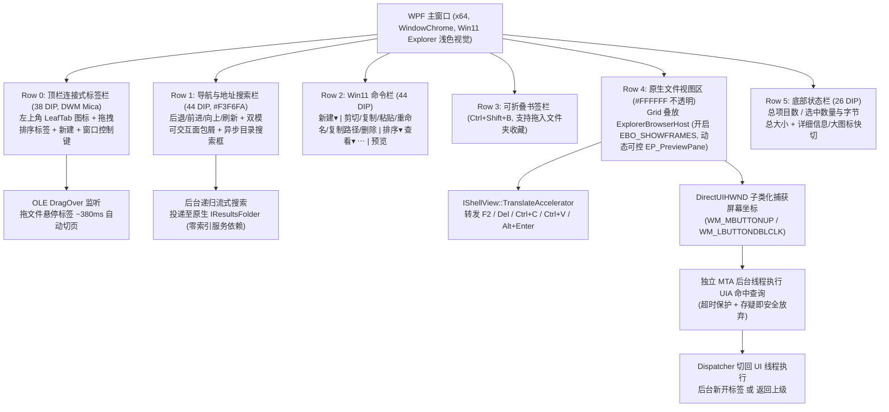

# LeafTab（一叶）架构设计与分阶段实施规范

## 1. 项目定位
**LeafTab（一叶）** 是一款面向 **Windows 10 x64（1903~22H2）与 Windows 11 x64** 的独立轻量级多标签资源管理器。
它通过托管系统公开 COM 接口 `IExplorerBrowser`（`SHELLDLL_DefView`）复用 Windows 原生文件浏览能力，并在外层通过 WPF（`.NET Framework 4.8`）构建与 **Windows 11 文件资源管理器**一致的现代多标签顶栏、面包屑导航栏、命令栏、可折叠书签栏与状态栏——**零 DLL 注入、零 BHO 寄生、零第三方依赖、无商业广告与后台常驻污染**。

---

## 2. 架构定型与六条核心工程边界

| 关键维度 | 实施准则 | 真实能力边界说明 |
| :--- | :--- | :--- |
| **编译位数与环境** | 强制锁定 **`x64`** + `.NET Framework 4.8` + `PerMonitorV2` | 仅编译 `x64` 才能完整加载 64 位系统的第三方 Shell 扩展（夸克网盘、7-Zip、TortoiseGit/SVN、WSL 等）；编译产物为纯净单文件 `LeafTab.exe` |
| **单进程线程边界** | 多标签共享同一 **STA UI 线程**；地址输入对网络路径做异步可达性预检 | 预检仅能改善“手动输入死链”体验，**无法防御**第三方右键扩展卡死或在左侧导航树点击已断开的共享盘——实测中如实记录表现 |
| **视图手势线程模型** | **严禁在 UI 线程同步调用 `IUIAutomation` 查询自身窗口**；统一派发至独立 **MTA 后台线程**（带短超时） | 规避 UIA 同线程自查询跨套间重入/死锁风险；**安全兜底原则：无法 100% 确认命中文件夹（`SFGAO_FOLDER` 且非压缩流 `SFGAO_STREAM`）或纯空白区（`UIItemsView`）时直接放弃手势**，绝不误开目录或误返上级 |
| **跨标签文件拖放** | **“拖文件 → 悬停目标标签 ~380ms → 自动切页（`SW_SHOW`/`SW_HIDE`）→ 放入原生视图”** | 不销毁源视图句柄、不断开系统 OLE `IDataObject` 拖放事务，完整保留复制/移动协商（兼容网盘、手机 MTP、压缩包） |
| **材质分区与浅色完整性** | 聚焦把 **Win11 现代浅色模式**做完整；仅顶栏 38 DIP 标签区启用 DWM Mica 云母，中间文件视图 100% 纯白不透明 | 确保原生 `SHELLDLL_DefView` 的 GDI ClearType 字体锐利不发虚；原生深色模式与后台标签休眠列为阶段三专项验证项 |
| **系统注册表接管** | 阶段三独立可选模块（默认关闭）；遵循 **“备份原值 + 恢复前校验当前值归属”** 双重安全锁 | 关闭开关时先检查当前注册表值是否仍指向 `LeafTab`：若是才恢复旧备份，若期间已被用户安装的其他工具改写则保留现状并提示 |

---

## 3. 界面分区与线程交互架构

---

## 4. 三阶段演进与实施状态

### 阶段一：核心原型与兼容性实测（已完成）
1. **工程与多标签核心骨架**（锁定 `PlatformTarget = x64`）：
   - 托管 `IExplorerBrowser (EBO_SHOWFRAMES)`，保留原生左侧导航树，剔除旧式冗余 `EP_Commands` 与内层状态栏；
   - 实现 `SW_SHOW`/`SW_HIDE` 秒级切页与 `IShellView::TranslateAccelerator` 完整快捷键转发。
2. **两大核心交互落地**：
   - **跨标签拖放文件衔接**：悬停目标标签约 380ms 自动切页，无缝保持系统 OLE 拖放事务；
   - **MTA 后台线程手势识别**：鼠标中键点文件夹后台新开标签、左键双击纯空白处返回上级。
3. **兼容性与资源压测基线**（详见 `COMPATIBILITY_REPORT.md`）：
   - 覆盖此电脑、回收站、WSL、网络死链异步超时预检、1 / 10 / 20 标签负载及 50 次反复开关句柄回落曲线。

### 阶段二：Win11 功能区对齐与日用效率完善（已完成 - v0.3.0）
1. **Win11 资源管理器同款功能区（保留左上角 LeafTab 专属图标）**：
   - **双模可交互面包屑地址栏**：支持点击任意层级跳转、中键点击层级在后台新开标签、点击 `>` 弹出带原生图标的子文件夹菜单、点击空白处或 `Ctrl+L` / `Alt+D` / `F4` 切换完整路径编辑、右侧 `☆/★` 一键收藏；
   - **异步流式目录搜索框（`Ctrl+F` / `F3`）**：支持通配符与子串递归匹配，通过原生 `IResultsFolder` 流式灌入搜索结果，随时 `Esc` 取消并还原原目录视图；
   - **Win11 命令栏**：
     - `⊕ 新建 ▾`：新建文件夹、文本文档（`.txt`）、Markdown（`.md`）、压缩文件夹（`.zip`），创建后自动选中并进入 `SVSI_EDIT` 内联重命名；
     - 常用操作组：`✂ 剪切`、`❐ 复制`、`📋 粘贴`、`[A|] 重命名`、`↪ 复制选中路径`、`🗑 删除`（随选中状态与剪贴板实时启停）；
     - `⇅ 排序 ▾`：按名称、修改日期、类型、大小及递增/递减排序（`IFolderView2::SetSortColumns`）；
     - `☰ 查看 ▾`：超大/大/中/小图标、列表、详细信息、平铺、内容视图切换，以及直接读写系统级**“文件扩展名”**与**“隐藏的项目”**开关（`SHGetSetSettings` + `SHChangeNotify` 实时刷新）；
     - `⋯` 更多菜单与右侧独立 `◫ 预览` 窗格开关（动态控制 `EP_PreviewPane`）。
2. **可折叠书签栏与增强状态栏**：
   - 书签栏（`Ctrl+Shift+B` 显隐，支持左键跳转、中键后台新开标签、直接从文件区拖放文件夹加入书签、右键管理）；
   - 底部状态栏实时统计 `N 个项目 | 选择了 M 个项目  X.XX MB`（基于 `IShellItem2::GetUInt64(PKEY_Size)` 计算选中文件总大小）与右下角 `[ ☰ | ⊞ ]` 视图快切。
3. **标签管理增强与会话持久化**：
   - 标签栏水平拖拽排序、`Ctrl+Shift+T` 恢复最近关闭标签（最多保留 20 条历史快照）、每标签独立前进/后退历史栈；
   - 零外部依赖 `config.json` 本地持久化（基于内置 `DataContractJsonSerializer`，默认存于 `%LOCALAPPDATA%\LeafTab\config.json`，仅程序旁存在 `.portable` 标记时使用同级配置；升级迁移保留源文件，已有有效目标配置优先），自动保存窗口位置、书签栏、最近目录及预览窗格状态；标签和前进后退历史仅在当前进程会话内保留，关闭窗口清空其标签。

### 阶段三：单实例汇聚、安全系统集成与数据可靠性加固（已完成 - v0.5.0）
1. **单实例多标签汇聚与命令行兼容（`SingleInstanceService`）**：
   - 基于当前登录用户作用域 `Mutex` + 异步并发 `NamedPipe`（`MaxAllowedServerInstances`），配合 `AllowSetForegroundWindow(ASFW_ANY)` 跨进程前台唤醒；
   - 完整兼容 `LeafTab.exe "<目录>"`、`/select,"<文件>"`、`/n,/e` 组合参数、直接传入非压缩包文件路径以及盘符根目录 `"%V "` 反斜杠引号转义，自动打开新标签并通过 `IShellView::SelectItem` 定位选中目标项。
2. **纯 `HKCU` 系统入口集成与 `DelegateExecute` 本地 COM 路由（默认关闭，位于 `⋯` 菜单）**：
   - **文件夹与磁盘右键菜单「在 LeafTab 中打开」**：注册 `Directory\shell`、`Directory\Background\shell` 与 `Drive\shell`；
   - **设为默认资源管理器（接管文件夹与 `Win + E`）**：覆盖 `Directory\shell`、`Drive\shell`、`Folder\shell`（含 `open` / `explore` / `opennewwindow` 显式动词）与 `CLSID\{52205fd8-5dfb-447d-801a-d0b52f2e83e1}`；通过内置 `IExecuteCommand`（`DelegateExecute`）智能分流：遇到控制面板/系统组件虚拟项时原位委托系统 `CLSID_ExecuteFolder`，在 LeafTab 自身视图及任何软件 `#32770` 文件打开/保存对话框内保持 **`0ms` 原位目录跳转**，而对桌面、`此电脑`、任务栏「文件资源管理器」、`Win + E` 及外部软件打开目录请求 100% 汇入 LeafTab；
   - **关闭窗口后热驻留秒开与原生窗口生命周期**：关闭主窗口时干净销毁当次窗口标签并进入零 CPU 热驻留（保留 1 个预热宿主供任意目标文件夹直接接管），使后续打开任意目录耗时降至毫秒级；同时在未选中项目时将 Win32 键盘焦点停靠于外层宿主窗口以彻底消除 DirectUI `ItemsView` 默认首项 `1px` 黑框，首键按下即无感归还焦点；
   - **安全备份、归属校验锁与路径自愈**：写入前备份原值至 `HKCU\Software\LeafTab\RegistryBackup`，关闭时校验归属权避免覆盖第三方工具；程序移动目录或升级后启动自动修复补全注册表路径，并提供 `--quit` 与 `--unregister-shell` 命令行控制开关。
3. **高性价比可靠性加固**：
   - 会话变更 `1.8s` 空闲防抖自动保存 + `File.Replace` 原子替换 + `.bak` 损坏自动回退恢复；
   - 新建文件采用 `FileMode.CreateNew`（`FileShare.None`）原子创建与后缀重试，杜绝并发覆盖；
   - 修正预热「此电脑」页签恢复历史与导航失败索引回滚，完善跨标签异步地址跳转/搜索防抖隔离与 `--self-test` 严格断言退出码。

### 阶段四：多窗口协同、开发者快捷流与公开发布防呆打磨（已完成 - v0.6.0）
1. **单进程多窗口协同（`App.ManagedWindows` + 双 `DelegateExecute` CLSID）**：
   - 支持 `Ctrl+N`、`--new-window`、系统右键 `Folder\shell\opennewwindow` 专属 COM CLSID、标签右键「移动到新窗口 / 在新窗口中打开」及标签垂直拖出撕裂分屏（通过 `ClosedTabSnapshot` 重建跨窗口页签并无损迁移历史栈）；
   - 按顶层窗口 `GA_ROOT` 句柄隔离 `ComponentDispatcher.ThreadPreprocessMessage` 键盘与鼠标侧键消息，多窗口共享书签栏与最近访问目录同步，关闭副窗口立即销毁，仅最后一个可见窗口进入热驻留。
2. **高频操作体验与开发者工作流补齐**：
   - 统一拦截 `WM_XBUTTONDOWN/UP` 与 `WM_APPCOMMAND` 实现全区域鼠标侧键前进/后退；
   - 外部重复打开已存在目录时跨窗口智能激活复用原页签（并刷新 `/select` 选中项）；
   - 地址栏支持 `wt` / `powershell` / `pwsh` / `cmd` / `code .` 原地启动与 `` Ctrl + ` `` 快捷键，配备悬浮 `Popup`（`Focusable="False"` 规避 `HwndHost` 空域遮挡与失焦冲突）实现最近目录历史与本地子文件夹 `Tab` 逐级自动补全；
   - 非激活/最小化窗口自动暂停 `350ms` 状态栏轮询，恢复激活时即时同步。
3. **易清理目录防误删自安装保护（`QuickLaunchAndInstallService`）**：
   - 检测 `Downloads / Desktop / Temp` 等易清理运行路径，在开启默认资源管理器时引导一键自我复制至 `%LOCALAPPDATA%\Programs\LeafTab\LeafTab.exe`、通过原生 `IShellLinkW` 生成开始菜单快捷方式并执行 `--handoff` 无缝进程接力；同时防止临时目录副本在启动自愈时反向覆盖已安装的固定路径。

## 5. 0.6.1 稳定性约定（2026-11-14）

- 主程序与安装器共用 `src/Shared/ShellAssociationRecovery.cs`。恢复以当前命令、COM 委托和精确安装路径为依据；键值缺失不代表有权清除备份。路径自愈保留人工修改和仍存在的另一安装位置。
- `AppConfigStore` 是进程内共享状态，窗口立即共享书签集合和全局选项，磁盘保存由一个计时器防抖。配置写入串行化并保留备份；旧配置迁移可重试，禁止用默认配置覆盖已有有效目标。
- 安装器只请求目标安装位置及明确接管的原安装退出，失败就停止；不强制杀进程。卸载先恢复关联和删除程序，再清理属于本安装的快捷方式与卸载入口；旧副本卸载不删除新副本使用的共享配置。
- 标签栏由裁剪的滚动视口承载，最小标签宽度真正生效，额外提供标签列表；系统菜单使用实际屏幕坐标转换，原生浏览器裁剪不共享跨窗口物理像素缓存。
- 地址补全使用有取消与并发上限的后台任务；限制返回结果数量，不截断输入目录范围。剪贴板按序列号缓存，隐藏项设置广播 ShellState，避免重建全局图标缓存。
- IPC 名称包含当前用户和会话身份，ACL 仅允许当前用户；消息上限 512 KiB、目标上限 128、读取截止时间 3 秒，PIDL 在进入原生方法前校验结构。
- COM 外部传入的共享 RCW 不做强制释放；局部获取的接口在其拥有的调用范围内释放。不使用的视图创建回调参数按 `IntPtr` 传递。
- 安装包从实际项目构建输出取得 EXE，嵌入 SHA-256 并在释放时核对。支持 `dotnet build` 与 Visual Studio MSBuild。
- `scripts/verify.ps1` 在项目外运行回归与原生自检。混合 DPI 双屏、Windows 10 和真实系统关联安装卸载仍需专门环境验收。
